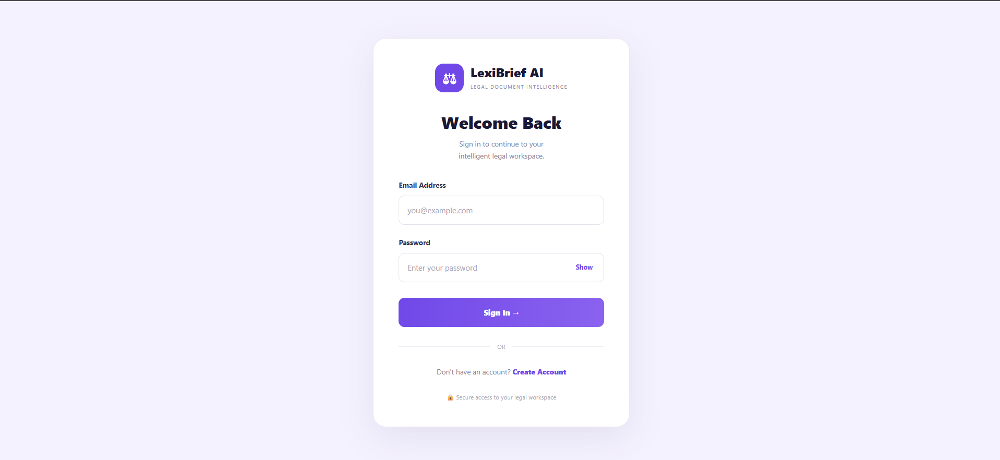
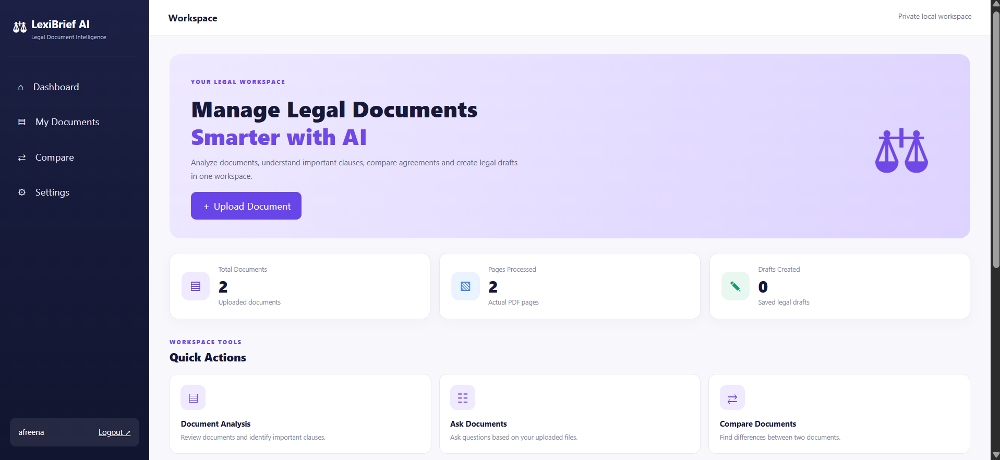
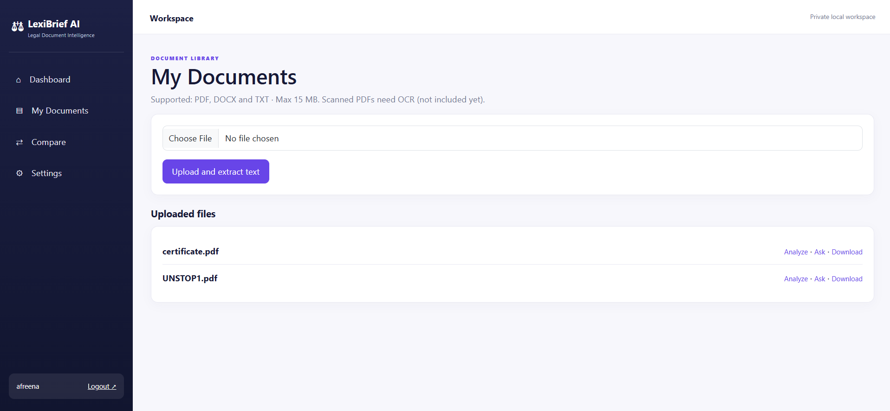
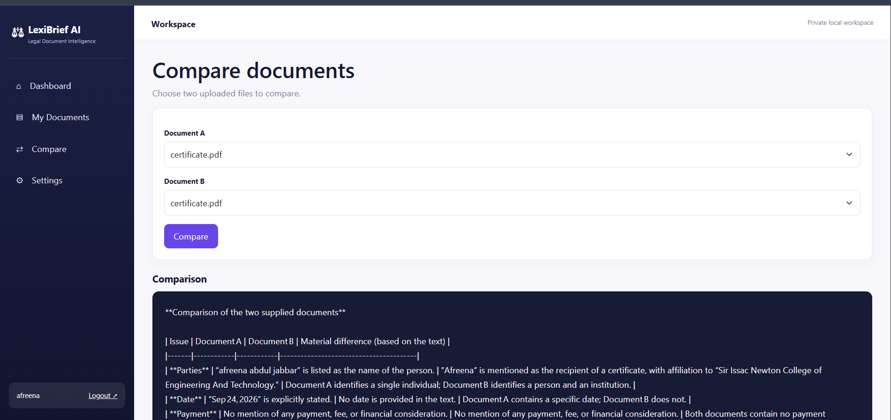
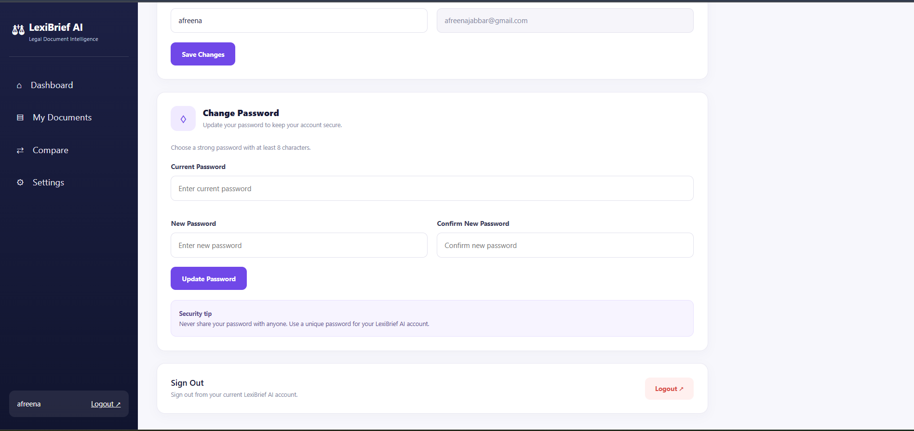

# ⚖️ LexiBrief AI

### AI-Powered Legal Document Intelligence

LexiBrief AI is an AI-powered legal document intelligence platform built using Python Flask, SQLite and Groq AI. It helps users understand legal documents through document analysis, question answering and document comparison.

> **Disclaimer:** LexiBrief AI is an informational assistance tool, not a replacement for qualified legal advice. AI-generated results should be independently verified.

---

## 📌 Problem Statement

Legal documents are often lengthy and difficult to understand. Identifying important obligations, deadlines, risky clauses and differences between document versions can take considerable time.

## 💡 Our Solution

LexiBrief AI provides an intelligent workspace that extracts text from uploaded legal documents and uses AI to assist users in reviewing and understanding their contents.

## 🚀 Key Features

- **User Authentication:** Registration, login and logout.
- **Document Upload:** PDF, DOCX and TXT support.
- **Text Extraction:** Extract text from uploaded documents.
- **AI Document Analysis:** Summaries, obligations, deadlines and potentially unclear clauses.
- **Ask Your Document:** Ask questions based on uploaded document content.
- **Document Comparison:** Compare two documents and identify differences.
- **Document Library:** View and download uploaded files.
- **Account Settings:** Update profile information and password.
- **Dashboard:** View document statistics and recent activities.

---

## 🖥️ Application Screenshots

### 1. Login Page



### 2. Dashboard



### 3. Document Analysis



### 4. Compare Documents



### 5. Account Settings



### 6. My Documents


### 7. Ask Your Document


---

## 🛠️ Technology Stack

| Component | Technology |
|---|---|
| Programming Language | Python |
| Backend Framework | Flask |
| Frontend | HTML, CSS, JavaScript, Bootstrap |
| Database | SQLite |
| AI Provider | Groq API |
| AI Model | Configured through GROQ_MODEL |
| PDF Processing | PyMuPDF |
| DOCX Processing | python-docx |
| Environment Variables | python-dotenv |
| Deployment Server | Gunicorn |
| Hosting | Render |

---

## ⚙️ How It Works

1. User registers or logs into LexiBrief AI.
2. User uploads a legal document.
3. The system extracts text from the document.
4. Extracted content is stored in SQLite.
5. User selects Analyze, Ask or Compare.
6. Flask sends the relevant document content to the configured Groq AI model.
7. AI generates a response.
8. The result is displayed in the application.

---

## 📂 Project Structure

```text
LexiBriefAI_Flask/
│
├── app.py
├── config.py
├── database.py
├── requirements.txt
├── README.md
├── .gitignore
│
├── services/
│   ├── __init__.py
│   ├── document_service.py
│   └── ollama_service.py
│
├── templates/
│   ├── base.html
│   ├── login.html
│   ├── register.html
│   ├── dashboard.html
│   ├── documents.html
│   ├── analyze.html
│   ├── ask.html
│   ├── compare.html
│   └── settings.html
│
├── static/
│   └── css/
│       └── style.css
│
├── uploads/
│
└── docs/
    └── screenshots/
        ├── login.png
        ├── dashboard.png
        ├── document-analysis.png
        ├── compare-documents.png
        ├── account-settings.png
        ├── document-library.png
        └── ask-document.png
```

---

## 💻 Installation and Setup

### Prerequisites

- Python
- Git
- Groq account
- Groq API key

### 1. Clone Repository

```bash
git clone https://github.com/AFree-123/LexiBrief_AI.git
cd LexiBrief_AI
```

### 2. Create Virtual Environment

```bash
python -m venv .venv
```

Activate on Windows:

```bash
.venv\Scripts\activate
```

### 3. Install Dependencies

```bash
pip install -r requirements.txt
```

### 4. Configure Environment Variables

Create a `.env` file in the project root.

```env
SECRET_KEY=your_random_secret_key
GROQ_API_KEY=your_actual_groq_api_key
GROQ_MODEL=your_available_groq_model_id
```

Generate a secure Flask secret key:

```bash
python -c "import secrets; print(secrets.token_hex(32))"
```

Get your Groq API key:

https://console.groq.com/keys

Use a model ID available to your Groq account.

**Never upload your `.env` file or API key to GitHub.**

### 5. Run Application

```bash
python app.py
```

Open:

http://127.0.0.1:5000

---

## 🔑 Environment Variables

| Variable | Purpose |
|---|---|
| SECRET_KEY | Flask session security |
| GROQ_API_KEY | Groq API authentication |
| GROQ_MODEL | Selected AI model |

---

## ☁️ Deployment

LexiBrief AI can be deployed using Render.

**Build Command**

```bash
pip install -r requirements.txt
```

**Start Command**

```bash
gunicorn app:app
```

Configure the following environment variables in Render:

- SECRET_KEY
- GROQ_API_KEY
- GROQ_MODEL

For persistent SQLite database and uploaded files, configure a persistent disk and update the application's database and upload paths accordingly.

A temporary filesystem may lose files after restarts or redeployments. SQLite with a local persistent disk is intended for a single application instance.

---

## ⚠️ Current Limitations

- Scanned PDFs require OCR, which is not currently implemented.
- DOCX and TXT page counts are not calculated.
- AI results depend on model availability and API limits.
- Long documents may be truncated before AI processing.
- AI-generated results require independent verification.

## 🔒 Privacy and Security

- API keys are stored in environment variables.
- Passwords are stored using password hashing.
- Uploaded documents should not be committed to GitHub.
- Document text sent for AI processing is transmitted to Groq.
- Avoid uploading confidential legal documents without authorization and reviewing the provider's data-handling terms.

---

## 🔮 Future Enhancements

- OCR support for scanned documents.
- Legal document draft generation.
- AI-powered document templates.
- Source and page highlighting.
- Exportable analysis reports.
- Automated testing and monitoring.
- Managed database integration.

---

## 👩‍💻 Author

**Afreena Abdul Jabbar**

GitHub: [AFree-123](https://github.com/AFree-123)

Project Repository: [LexiBrief AI](https://github.com/AFree-123/LexiBrief_AI)

---

### LexiBrief AI

**Understand Legal Documents with AI Assistance.**